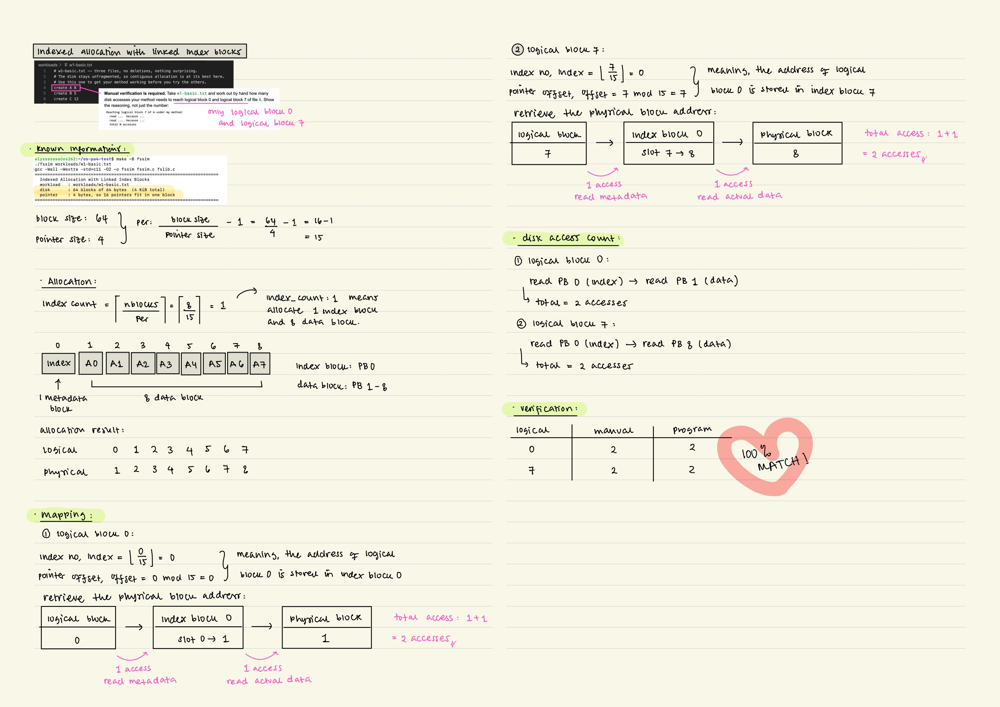

## Programming Assignment 4 Type 4
Indexed Allocation with Linked Index Blocks<br>
Authored by: Alyssa Rahma Adjani & Paramita Santoso

Slide references (page numbers are PDF pages): 
- **[IO]** = `W0809-mass-storage-input-output.pdf`
- **[FS]** = `W0809-filesystem.pdf`

### Member contributions
| Member | Student ID | Contribution |
| --- | --- | --- |
| Alyssa Rahma Adjani | 2506558466 | - completed `fssim.c`<br>- made presentation slides<br>- manual verification |
| Paramita Santoso | 2506554171 | - authored `explanation.md`<br>- captured outputs|

---
### QnA: Part 1 (`iolab`)

#### 1. Why is one system call per byte so much slower than one per 64 KiB, when the bytes written are identical?

Timings for the same 131,072 bytes (128 KiB). First run in ~/os-pa4-type4:

| method | elapsed | `write()` calls |
|---|---|---|
| stdio `fputc`, default buffer (BUFSIZ = 8192) | 6.94 ms | ~16 (hidden in stdio) |
| stdio `fputc`, 64 KiB buffer | 5.78 ms | ~2 (hidden in stdio) |
| `write()` one byte at a time | 843.24 ms | 131,072 |
| `write()` in 64 KiB blocks | 1.05 ms | 2 |

**Mechanism:** every `write()` is a system call. A user process cannot perform I/O itself (I/O instructions are privileged), so each call traps into the kernel, the kernel dispatches to the right handler, does the work, and returns to user mode. This incurs mode-switching, parameter validation, and kernel dispatch costs. Crossing cost is paid once per call, regardless of how many bytes the call carries. With 131,072 calls we pay it 131,072 times. With two calls we pay it twice. With `fputc()`, stdio collects bytes in a user-space buffer before calling `write()`. In the 64 KiB block test, our program passes a full buffer directly to each `write()`, reducing 131,072 write calls to 2.

**Lecture slide:**
- [IO] p.62 (*Error Handling & I/O Protection*, "any I/O operation must be performed indirectly via system calls" and the figure "Use of a System Call to Perform I/O": trap to kernel, dispatch, perform I/O, return);
- [IO] p.59-60 (*Kernel I/O Subsystem*, buffering);
- [IO] p.68 (*Improving I/O Performance*: fewer context switches, transfer data in larger chunks);
- [IO] p.57 (*Vectored I/O*: with scatter-gather, fewer system calls means less overhead).

#### 2. What per-system-call cost did `iolab` measure on your machine, and did it warn you the file system was slow?

> If it did, say what causes that and what it tells you about where the cost of I/O actually lives. If you can, run it on both a `/mnt/...` path and a native Linux path and report both.

We ran `iolab` three times (WSL2, Ubuntu). `iolab` first calibrates the cost of one `write()`, prints a warning if it is very slow, and shrinks the payload accordingly.
 
| run | where | calibrated cost per `write()` | payload | warning? | average per call in the one-byte loop |
|---|---|---|---|---|---|
| 1 | `~/os-pa4-type4` (native Linux path) | **8.030 µs** | 128 KiB | no | 843.24 ms / 131,072 = 6.43 µs |
| 2 | `/mnt/c/iolab-test` | **1.529 µs** | 256 KiB | no | 420.93 ms / 262,144 = 1.61 µs |
| 3 | `~/os-pa4-type4` again, right after run 2 | **315.010 µs** | 4 KiB | **yes** | 14.91 ms / 4,096 = 3.64 µs |
 
**What we observed.** On run 1 and run 2, `iolab` was quick and gave no warning. After that, when we went back to `~/os-pa4-type4` and ran it again (run 3), the "very slow system call" warning appeared (315 µs).

**What it tells us.**
- The calibration averages 512 one-byte writes. Run 3 triggered the warning on the native Linux path, yet its longer one-byte loop averaged only 3.64 µs per call. These measurements alone cannot tell us what caused the slow calibration or how much time any write spent on the device.
- Batching reduces the number of trips into the kernel. In run 1, writing the same 128 KiB took 843.24 ms one byte at a time and 1.05 ms in two large writes. ([IO] p.66, I/O layers)

#### 3. The sparse file

> The sparse file reports a size of 8 MiB while occupying almost no blocks. Quote its size and its allocated blocks. How is that possible, and which part of Part 3 is the same idea?

* `iolab-sparse.dat` reports a logical size (`st_size`) of **8,388,608 bytes (8 MiB)**, while occupying only **8 reported units of 512 B = 4,096 bytes** (one 4 KiB file-system block).
* **How this works:** When `lseek()` skips ahead to 8 MiB − 1 and writes a single byte, the file system only allocates a physical block for the tail end containing actual data. The unallocated logical blocks are recorded as a **hole** (null/unmapped pointers in the file's block map) rather than wasting disk blocks full of zeroes; reading a hole returns zeroes without fetching a data block for that range.
* This has the same idea as **Part 3 (Indexed Allocation)**: both use a **mapping from logical block to physical block**. A sparse file can leave a logical block unmapped. Our simulator allocates every requested data block and records its address in `f->data[logical]`.

#### 4. Hard Link vs. Symbolic Link

> Compare the hard link with the symbolic link. Quote the inode number and link count of all three files. What exactly is a hard link, what is a symbolic link, and what happens to each if the original is deleted?

From run 1:

| file | inode | link count | size | allocated |
|---|---:|---:|---:|---|
| original `iolab-out.dat` (after linking) | 1441947 | 2 | 131072 B | 256 blocks |
| hard link `iolab-hard.lnk` | 1441947 | 2 | 131072 B | 256 blocks |
| symbolic link `iolab-sym.lnk` | 1442073 | 1 | 13 B | 0 blocks |

(Before the links existed, the original had link count 1.)

- A **hard link** is a second directory entry (name) pointing to the *same inode*. There is one file with two names, which is why the inode number is identical and the count went from 1 to 2. Neither name is "the original". If `iolab-out.dat` is deleted the count drops to 1, the inode and data stay, and `iolab-hard.lnk` still works. The data is freed only when the count reaches 0 (and no process has it open).
- A **symbolic link** is a separate small file with its own inode whose content is a path string. Its size, 13 bytes, is the length of `iolab-out.dat`, and it needs no data block (0 blocks). If the original is deleted the symlink survives but **dangles**: opening it fails with "No such file or directory", because it only stored the name.


---
### QnA: Part 2 (`disksched`)

#### Does the run reproduce the slides?

Yes, for every figure the slides give.

**ex2 (slides 20 to 22, head at 80, moving downward):**

| algorithm | slide | our run |
|---|---:|---:|
| FCFS | 810 | 810 |
| SSTF | 219 | 219 |
| SCAN | 255 | 255 |
| LOOK | 219 | 219 |
| C-SCAN | 368 (169 without the return jump) | 368 (169) |
| C-LOOK | 284 (127 without the return jump) | 284 (127) |

The service orders match the slide paths too (e.g. SCAN `80 → 64 → 42 → 32 → 18 → 0 → 110 → 145 → 150 → 175`).

**ex1 (slides 14 to 18, head at 53):** FCFS 640 (slide 14) and SSTF 236 (slide 15) match. SCAN 236 (slide 16) matches the *down* column. C-SCAN 382 (slide 17), and its path `53 → 65 → … → 183 → 199 → 0 → 14 → 37` runs upward, so it matches our *UP-first* column (382). Slide 18 shows LOOK going down first (`53 → 37 → 14 → 65 …`, which matches the path shown in the output; our *down* column: 208) and C-LOOK going up first (`53 → … → 183 → 14 → 37`, our UP column: 322). The lecture mixes directions for ex1, and because `ex1-lecture.txt` gives no previous request the program shows both columns. The numbers agree once the right column is read.


#### Two things the slides gloss over

* **Why SSTF and LOOK tie at `219` on `ex2`, and what separates them:**
  * On `ex2`, the head starts at `80` moving downward, and the requests below it (`64, 42, 32, 18`) are spaced closely together (`16, 22, 10, 14` cylinders apart), while the nearest upward request (`110`) is `30` cylinders away. At every downward step, the closest unvisited request happens to lie in the downward direction (`80 -> 64 -> 42 -> 32 -> 18`). Once at `18`, both algorithms sweep upward through `110 -> 145 -> 150 -> 175`, producing the exact same service order and total (`219`).
  * **Workload that separates them:** Adding a close request just above the starting head—such as cylinder **`85`**—separates them. **SSTF** will immediately reverse upward to `85` (distance `5` vs. `16` to `64`), whereas **LOOK** strictly finishes all downward requests (`64 -> 42 -> 32 -> 18`) before reversing to service `85`.

* **C-SCAN / C-LOOK Wrap-Around Seek (`368` vs `169` and `284` vs `127`):**
  * **What it is:** On ex2, C-SCAN wraps between disk endpoints (`0 -> 199`, 199 cylinders). C-LOOK wraps between the outermost pending requests (`18 -> 175`, 157 cylinders). Neither serves a request along the way.
  * **Why textbooks disagree:** One convention counts all physical head movement. The other omits the return seek because the head serves no requests along the way.
  * To predict real performance we would use the **figure that includes it** (`368` and `284`): the head physically has to make that trip and every pending request waits for it. Although the arm does not stop mid-flight during the return sweep, a mechanical actuator must still physically traverse those tracks across the platter, incurring real seek latency before it can read at the opposite edge.


---
### How the program works

```c
int fs_allocate(Disk *d, File *f, int nblocks)
{
    int per = d->block_size / d->ptr_size - 1;
    int index_count = (nblocks + per - 1) / per;
    if (index_count < 1)
        index_count = 1;

    if (alloc_meta(d, f, index_count, f->index_chain) != 0)
        return -1;

    f->nindex = index_count;
    return alloc_data(d, f, nblocks);
}

int fs_map(Disk *d, const File *f, int logical)
{
    int per = d->block_size / d->ptr_size - 1;
    int which_index = logical / per;

    for (int i = 0; i <= which_index; i++)
        disk_read(d, f->index_chain[i]);

    return disk_read(d, f->data[logical]);
}
```

Each file gets a chain of index blocks. Each block holds `block_size / ptr_size` pointers (64 / 4 = 16 by default), and **one slot is used as the link** to the next index block, so each index block holds **`per = ppb - 1 = 15`** usable data pointers.

- `fs_allocate()`: needs `ceil(nblocks / per)` index blocks (at least 1). It gets them in a single `alloc_meta()` call into `f->index_chain`, sets `f->nindex`, then allocates the data blocks.

- `fs_map(logical)`: when mapping a `logical` block in `fs_map()`, the program calculates which index block in the chain holds the pointer (`which_index = logical / per`). Because index block *k* can only be located by reading the link pointer stored inside index block *k-1*, the simulator reads every index block from `0` up to `which_index` before reading the target data block. Cost: **`(logical / per) + 2` disk accesses**.

**Lecture slide:**
* [FS] p.45 (the index-table figure: the *i*-th entry points to the *i*-th logical block, unused slots are -1)
* [FS] p.49-50 (*Performance: Contiguous vs Linked vs Indexed*) is the slide for the cost trade-off: indexed needs index-block reads before the data block.


### Addressing limit

The method itself has **no limit**: the chain of index blocks can grow indefinitely (`fs_max_file_blocks()` returns −1, and the program prints "no limit from the method itself"). What grows is the cost.

| geometry | slots per block | data pointers per index block (`per`) | one index block covers | cost of logical block `L` |
|---|---:|---:|---|---|
| default, `-s 64 -p 4` | 16 | 15 | 15 blocks = 960 B | `L / 15 + 2` |
| `-s 4096 -p 4` | 1024 | 1023 | 1023 blocks = 4,190,208 B (about 3.996 MiB) | `L / 1023 + 2` |

For comparison, the single index block of topic 3 stops at 16 blocks (default) or 1024 blocks (4 MiB at `-s 4096`). The two-level scheme of topic 5 reaches 1024 × 1024 = 1,048,576 blocks = 4 GiB at 4 KiB blocks. ch14 itself says the linked scheme has "no limit on size", which agrees with the program. To address the same 4 GiB file (1,048,576 blocks) the chain needs ceil(1,048,576 / 1023) = **1026** index blocks, and its very last block would cost floor(1,048,575 / 1023) + 2 = **1027 accesses**, against 3 for two-level indexing.

On the default empty 64-block disk the largest file is 60 data blocks plus 4 index blocks = 64.


### Results on the five workloads
 
| workload | files placed (contiguous / ours) | data blocks | metadata blocks | sequential accesses (contiguous / ours) | accesses per data block (contiguous / ours) |
|---|---|---:|---:|---|---|
| w1-basic | 3 / 3 | 25 | 3 | 25 / 50 | 1.00 / 2.00 |
| w2-frag | 4 / **5** | 42 vs 54 | 5 | 42 / 108 (**not comparable**) | 1.00 / 2.00 |
| w3-big | 3 / 3 | 44 | 5 | 44 / 98 | 1.00 / 2.23 |
| w4-many | 10 / 10 | 30 | 10 | 30 / 60 | 1.00 / 2.00 |
| w5-edge | 5 / 5 | 37 | 7 | 37 / 77 | 1.00 / 2.08 |


### Comparison against Contiguous Allocation

**What our code does better and why:**<br>
- **No external fragmentation, so nothing is refused for lack of a contiguous run.** In `w2-frag.txt` the deletions leave the free space in separate runs; contiguous placed only 4 of the 5 files (no free run was long enough for the 12-block file G) while ours placed **all 5**, scattering data blocks anywhere free. The library calls this the headline result on this workload. (The `create G ... FAILED, not enough room` line in that run belongs to the contiguous replay inside `print_vs_contiguous`, not to our method; our table shows G placed.)
- **No ceiling on file size, unlike a single index block.** `w3-big.txt` (20-block files) and the 16- and 17-block files in `w5-edge.txt` are all placed (98 and 77 accesses). Per the assignment, the single index block of topic 3 places only 1 of the 3 files in `w3-big.txt` and refuses the other two, because one index block addresses 16 blocks. Each additional index block extends the file and costs one extra read to reach.
- **Random access without pointer chasing through the data.** Unlike linked allocation ([FS] p.41-42), we reach block `L` by walking `L/15 + 1` index blocks, not `L` data blocks.
<br>

**What it does worse or what it costs:**<br>
- **Extra accesses on every read.** At least one index read before every data block: 2 accesses where contiguous needs 1, so sequential reads are 2.00x per data block on w1, w2 and w4 (`start + logical` needs no metadata at all). Beyond block 14 the cost grows by one per 15 blocks: 3 for the last 5 blocks of each BIG file, 3 for the last block of EXACT16 and last 2 of OVER17.
- **Metadata blocks.** 3, 5, 5, 10 and 7 blocks on w1-w5; contiguous uses none. As a share of data blocks: w1 12%, w2 9%, w3 11%, w5 19%, **w4 33%**.
- **Smaller free runs.** On these workloads the extra metadata consumes blocks and leaves a smaller free run (w1: 39 → 36, w3: 20 → 15, w4: 34 → 24).
- **Worst case grows without bound.** At 4 KiB blocks a 4 GiB file's last block costs 1027 accesses (see Addressing limit).
- **Reliability and complexity.** The chain of index blocks can break at one lost link, and allocation, growth and recovery code are more complex than `start + logical`.
- **A caveat on how the simulator counts.** For each lookup, `fs_map()` re-reads the chain from the file’s first index block (physical block 0 for file A in the verbose trace). If a real system keeps those index blocks cached during a sequential read, it can fetch each index block once and reuse it for later data blocks. ([IO] p.59-60, caching)
<br>

**Which workload shows the biggest difference and why that one:**<br>
- **Biggest difference in cost: `w3-big.txt`.** +54 accesses over contiguous on the same 44 data blocks (98 vs 44), and 2.23 accesses per data block, the highest of the comparable workloads. It has the most reads that reach a second index block: each 20-block file has 15 blocks at cost 2 and 5 blocks at cost 3 (45 accesses), and the last block of each BIG file costs 3 against contiguous's 1 (comparison row: last block 8 vs 3).
- **Biggest difference in outcome: `w2-frag.txt`.** Contiguous fails to place a file that ours places.
- **Biggest metadata cost: `w4-many.txt`.** Ten 3-block files each need their own index block, so 10 of 40 used blocks (25%) are metadata, and each index block uses only 3 of its 15 pointer slots. Contiguous has no per-file metadata.
<br>

**Are the totals comparable?**<br>
- **w1, w3, w4, w5: yes.** Both methods placed the same files and the same number of data blocks (25, 44, 30, 37), so the access totals count the same work and the differences (+25, +54, +30, +40) are real costs.
- **w2: no.** Ours placed **5** files and contiguous only **4**, so the totals (108 vs 42) count different work. The program says so, and the +66 must not be read as a cost of the method. Our 108 accesses include file G (12 blocks, 24 accesses) that contiguous never read. Comparing accesses per data block: contiguous **1.00**, ours **2.00**, the same 2.00 as w1 and w4. Compared on the same 4 files, it will be 84 (ours) against 42 (contiguous), exactly twice.
<br>


### Which of the three would we ship?
 
Of topic 3 (single index block), topic 4 (this method) and topic 5 (two-level index):
 
| | topic 3 | topic 4 (ours) | topic 5 |
|---|---|---|---|
| cost of any block | 2 (flat) | `L / 1023 + 2` at 4 KiB blocks | 3 (flat) |
| maximum file size at 4 KiB blocks | 1024 blocks = 4 MiB | unbounded | 1,048,576 blocks = 4 GiB |
| worst-case cost for a 4 GiB file | cannot hold it | 1027 | 3 |
 
Ours costs 2 accesses (like topic 3, and cheaper than topic 5's 3) for logical blocks 0-1022 (about 4 MiB at 4 KiB blocks), equals topic 5 at 3 up to block 2045 (about 8 MiB), and is worse from block 2046 on, with the gap growing. Small files benefit from the short chain, but reads near the end of a large file must traverse every preceding index block.
 
**We would ship topic 5 (two-level)**: every lookup takes 3 accesses for files up to 4 GiB, giving a predictable read count. For a real design we would go one step further and use the UFS combined scheme ([FS] p.47-48: 12 direct pointers for small files, then single, double and triple indirect), where the first 12 data blocks can be reached directly from the inode and larger files use up to three levels of indirection.

### Manual verification: `w1-basic.txt`



#### 1. Preparation

**Rules used**

- The default disk has 64 blocks of 64 bytes each. With 4-byte pointers, each index block has `ppb = 64 / 4 = 16` slots.
- The last slot links to the next index block, leaving `per = ppb − 1 = 15` slots for data addresses.
- Each lookup starts at the first index block. Count one read for each index block visited and one for the requested data block.

The first command in `w1-basic.txt`, `create A 8`, creates file A with logical blocks 0–7. We trace the first and last blocks by hand.

#### 2. Allocation

For A, `fs_allocate()` needs `index_count = ceil(8 / 15) = 1` index block. A is created first on an empty disk. The allocator reserves physical block 0 for its index, then physical blocks 1–8 for its data. A occupies nine physical blocks in total.

| Logical block in A | 0 | 1 | 2 | 3 | 4 | 5 | 6 | 7 |
| --- | --- | --- | --- | --- | --- | --- | --- | --- |
| Physical data block | 1 | 2 | 3 | 4 | 5 | 6 | 7 | 8 |

In the index layout, slots 0–7 hold these eight addresses. Slots 8–14 are unused. Slot 15 is reserved for the link, and A has no next index block.

#### 3. Mapping

For a logical block `logical`, integer division gives its index block’s zero-based position in the chain, `which_index = logical / per`. The remainder, `logical % per`, gives the pointer offset in slots within that index block. In the simulator, `f->index_chain[which_index]` holds the physical index block address, and `f->data[logical]` holds the physical data block address.

| Logical block in A | Chain position (integer division) | Pointer offset (slot) | Physical index block | Physical data block |
| --- | --- | --- | --- | --- |
| 0 | `0 / 15 = 0` | `0 % 15 = 0` | 0 | 1 |
| 7 | `7 / 15 = 0` | `7 % 15 = 7` | 0 | 8 |

#### 4. Disk Access Counting

`fs_map()` reads the index blocks from chain position 0 through `which_index`, then reads the requested data block. The total is `floor(logical / per) + 2`: one read for the first index block, one for the data block, and one more for each additional index block traversed.

| Reaching logical block 0 of A under my method |
| --- |
| Read physical block **0** because A’s first index block contains the pointer in slot 0.<br>Read physical block **1** because slot 0 points to the requested data there.<br>**Total: 2 accesses** (1 metadata read + 1 data read), matching `floor(0 / 15) + 2 = 2`. |

| Reaching logical block 7 of A under my method |
| --- |
| Read physical block **0** because slot 7 is still in A’s first index block.<br>Read physical block **8** because slot 7 gives its address directly. We can skip the seven preceding data blocks.<br>**Total: 2 accesses** (1 metadata read + 1 data read), matching `floor(7 / 15) + 2 = 2`. |

#### 5. Verification

The saved output for `./fssim workloads/w1-basic.txt -v` shows A’s allocation:

```text
  create A, 8 blocks
      metadata   : 0
      data blocks: 1 2 3 4 5 6 7 8
```

The first-block lookup in the verbose trace reads:

```text
        read block   0 (metadata)
        read block   1 (data)
```

The last-block lookup reads:

```text
        read block   0 (metadata)
        read block   8 (data)
```

| Logical block in A | Manual accesses | Program accesses | Result |
| --- | --- | --- | --- |
| 0 (first) | 2 | 2 | Match |
| 7 (last) | 2 | 2 | Match |

#### 6. Conclusion

Both lookups reach the predicted physical data block in two reads. A’s eight addresses fit in one index block. The other files in `w1-basic.txt` also fit within the 15-pointer capacity, so this workload shows only the first step of the access-cost staircase.
